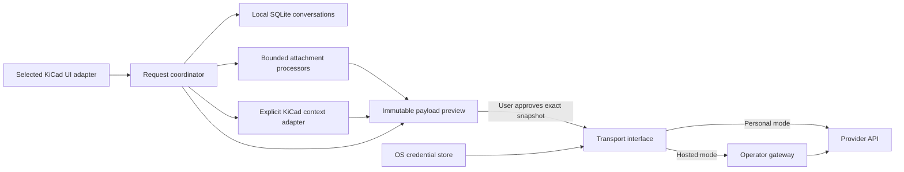

# Proposed architecture

Historical feasibility proposal. The accepted release implementation is documented in [IMPLEMENTATION.md](IMPLEMENTATION.md).

Status: provisional boundaries, not a commitment to a UI host. Only contracts and offline prototypes exist.

## Separation from the UI decision

Core conversation, payload and transport logic does not import pcbnew or wx. A host adapter owns focus, editor lifecycle and thread marshaling. The legacy probe is under prototype/, outside the installable package. A future IPC adapter uses the stable official client; an unsupported dock adapter would be separately version-gated and optional. No UI host is selected by silently falling back to a companion.

Proposed modules after approval: `conversations` (SQLite repository), `attachments` (bounded extraction workers), `context` (read-only snapshots), `review` (immutable serialization/digest), `coordinator` (state machine), `transports` (personal and hosted), `credentials` (OS store), `ui` (selected adapter). `contracts.py` sketches interfaces only.

## Request state and concurrency

Draft -> Preparing -> Review -> Approved -> Sending -> Streaming -> Completed / Cancelled / Failed. Approval is bound to the exact serialized bytes, destination and model. Any mutation returns to Draft. A request ID and conversation ID travel with every event; a late event for a cancelled/deleted conversation is ignored. A bounded worker handles extraction/network I/O; the KiCad GUI thread only reads small snapshots and paints queued updates. Closing the UI cancels local work and tears down timers/handlers before widgets are destroyed.

SQLite stores normalized conversations/messages and attachment metadata with migrations and transactions. Managed attachments are content-addressed local copies, retained only by deliberate product policy; no implicit reference to mutable original bytes is sent after review. Provider response items needed to continue a conversation must be preserved alongside displayed text without exposing hidden state as visible prose.

## OpenAI API guidance checked 2026-10-24

Use the Responses API with foreground SSE streaming. Handle typed text deltas, completion and errors; preserve relevant response items for manual history replay. Keep conversation state locally with `store=false` and avoid server-side Conversations objects for the basic privacy model. `store=false` is not a promise of zero provider retention; provider abuse-monitoring/data policies still apply. Sources: [streaming](https://developers.openai.com/api/docs/guides/streaming-responses), [conversation state](https://developers.openai.com/api/docs/guides/conversation-state), [data controls](https://developers.openai.com/api/docs/guides/your-data).

Responses supports file inputs, including PDF and non-PDF documents; supported input formats and model modalities must be checked when enabling them. The documented file ceiling is 50 MB across a request, with individual files under 50 MB. Our lower application limits and local extraction policy take precedence. Sending PDFs can include page images and thus higher token usage; extracted DOCX text does not preserve embedded charts. Source: [file inputs](https://developers.openai.com/api/docs/guides/file-inputs).

Select a model from actual account capabilities and cost/quality tests after the UI choice. Do not make this milestone depend on a paid key, an untested model name or an assumed quota. No API SDK or provider call is installed/executed here.

Client stream closure is a local cancellation action, not a guarantee that all server computation or billing stops. Do not misuse a background-response cancellation endpoint for foreground SSE. Hosted cancellation must address a gateway request ID and abort its upstream transport. Distinguish partial output from completed answers.

## Hosted gateway proposal

An optional HTTPS service owns authentication, a server-side provider credential, allowance accounting and an allowlisted model configuration. A reviewed payload is authorized on the client but validated again by the gateway. Never offer an arbitrary URL proxy or accept client-supplied provider keys in operator-funded mode. Rate limits and hard budgets fail closed, and the app offers a deliberate switch to personal mode without silently transmitting data again. No payments or subscription logic is required for operator sponsorship itself.

No prompt/attachment persistence is proposed on the gateway by default. The deployment must document unavoidable logs, deletion/retention and provider processing before public service activation. Hosted operations and funding need a separate release gate.

## Maintenance boundaries

Keep testing of wx ownership/docking, editor instance lifetime and API capability separate from model quality. A dock can work today while being unsuitable as a stable public extension. The core should survive removal of the legacy UI adapter. A KiCad fork must be developed and licensed separately, with explicit update/build/security maintenance ownership.
