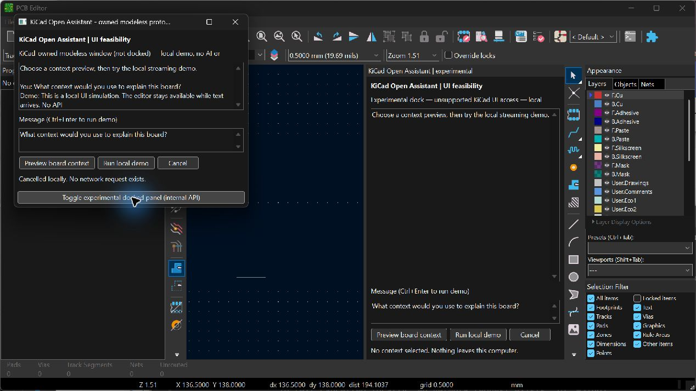
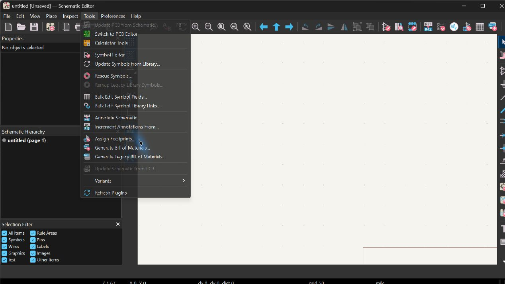
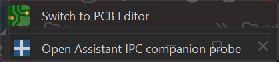

# UI feasibility results

Test date: 2026-10-24. This is an offline prototype report, not product acceptance.

## Environment

| Component | Actual value |
|---|---|
| Host | Windows NT 10.0.26200.0, installed `C:\Program Files\KiCad\10.0` |
| KiCad | Product 10.0.7; executable file version 10.0.7.51283; `pcbnew.Version()` 10.0.7 |
| Embedded Python | 3.11.5 |
| wxPython | 4.3.1 msw (phoenix), wxWidgets 3.3.3 |
| Editors | Separate PCB and schematic executables; empty disposable documents |
| Profiles | Repository `.runtime/config` and `.runtime/ipc-config`; generated plugins in `.runtime` |
| API dependencies | No SDK installed; `kipy` absent; no OpenAI key loaded or paid request made |

Native UI was operated and inspected with the installed computer-use skill. The owner completed first-run privacy setup. A sandbox-launched initial PCB process did not expose a usable editor; subsequent interactive launches used the approved desktop execution path. This is an environment limitation, not evidence that the plugin failed to register.

Repository checks passed: five Python files compile, project TOML parses, generated manifest targets resolve, and Markdown links resolve. A full before/after file-set and SHA-256 comparison found all 53 investigation files unchanged. See [verification record](test-evidence/verification.json). No full-product test suite or API evaluation is claimed.

## Results

| Test | Actual result / evidence |
|---|---|
| PCB plugin discovery | PASS: registered and invoked from the real editor |
| Owned modeless window | PASS: shown in PCB process; `GetParent()` matches editor; not modal |
| Explicit context preview | PASS on empty board: accepted preview contains only unsaved-board label, zero footprints/tracks and offline destination |
| Local simulated streaming | PASS: text visibly progressed without a blocking dialog |
| Cancellation | PASS: Cancel stopped an active timer (`was_running=true`); this is not provider cancellation |
| True docking | PASS for this build: AUI manager found, AddPane succeeded, pane valid and docked, parent is editor; editor layout visibly includes panel |
| Close/detach lifecycle | PASS for one cycle: closing the owned window logged dock removal and window close; repeated reload/shutdown stress remains untested |
| Legacy schematic host | NOT AVAILABLE through tested path: no legacy probe entry point; official bindings describe PCB only |
| PCB IPC launch | PASS: toolbar action launched PID 19552 from PCB PID 40624; socket/token presence true, values never recorded |
| Schematic IPC launch | PASS: action appeared in toolbar overflow, then maximized toolbar; launched PID 39672 from schematic PID 32104; socket/token presence true |
| External IPC probe GUI | UNRESOLVED: launched pythonw processes remained alive but exposed no targetable top-level window during inspection. Do not count this as a working companion GUI |
| IPC design data exchange | NOT TESTED: probe inspects environment presence only, performs no RPC |
| Schematic docking/owned panel | NOT DEMONSTRATED: no supported host extension hook identified |
| AI, attachments and saved conversations | NOT IMPLEMENTED: proposed release requirements only |

The schematic action result conflicts with the version boundary in [current official IPC docs](https://dev-docs.kicad.org/en/apis-and-binding/ipc-api/for-addon-developers/). The result proves action launch on this installation, not all schematic API commands or general KiCad 10 compatibility. No claim of unsupported schematic embedding follows from a toolbar icon.

## Screenshots

The right-hand panel is the actual dock. The separate window is explicitly labeled modeless. Both are original offline UI probes.

Screenshots are KiCad/prototype surfaces from empty documents. They are not proprietary-plugin evidence. Accessibility snapshots and selected sanitized runtime events are in `test-evidence/`.

## Reproduction and observed setup issues

Use the commands in [README](../README.md). The legacy launcher copies only our original probe into the isolated profile's `10.0/scripting/plugins` directory. Invoke it, preview context, start/cancel the demo, then toggle the dock. Closing the modeless window is intended to detach the dock and stop timers.

For IPC, complete the isolated first-run setup, close any previous IPC test editor, then run `launch_probe.ps1 -Ipc` or add `-Editor schematic`. Use the original blue/white plus toolbar icon (or toolbar overflow). The manifest is generated for this machine and references the installed interpreter; it is not a release package.

The installed Windows build appends `KiCad/10.0/plugins` to the environment override `KICAD_DOCUMENTS_HOME`. This was checked against the [public KiCad path implementation](https://raw.githubusercontent.com/KiCad/kicad-source-mirror/10.0/common/paths.cpp). Initial placement one directory too high was corrected. An absolute action entrypoint was rejected: the [public manifest parser](https://raw.githubusercontent.com/KiCad/kicad-source-mirror/10.0/common/api/api_plugin.cpp) requires a relative entrypoint. The generator now creates a relative reference and an original geometric PNG icon. Restart was required to get the corrected action onto the toolbar in this test; legacy Refresh Plugins alone did not establish it.

The initial IPC GUI attempted tkinter, but this bundled Python lacks `_tkinter`; it was replaced by wx. The revised process-launch test succeeds, while visible external wx initialization remains unresolved. Investigate with bounded initialization logging before implementing option C. No private token or full API traffic logging is needed for that debugging.

## Limits and further checks after the hosting decision

Only this Windows/KiCad/Python/wx combination was exercised. High DPI and different themes, screen readers, keyboard-only operation, repeated dock lifecycle, multiple open editors, project switches, populated/large boards, editor shutdown during work, Linux/macOS and KiCad 11 remain release checks. The minimum window size was increased after an early clipped transcript; narrow dock wrapping is still unfinished. The keyboard bindings exist but full keyboard accessibility is not claimed.

The local timer demonstrates event-loop responsiveness, not production network threading. The preview demonstrates explicit selection of minimal metadata, not a secure general attachment pipeline. The probe never modifies a board or schematic. The next implementation phase requires a UI choice and the feature gates in [ACCEPTANCE](ACCEPTANCE.md).
