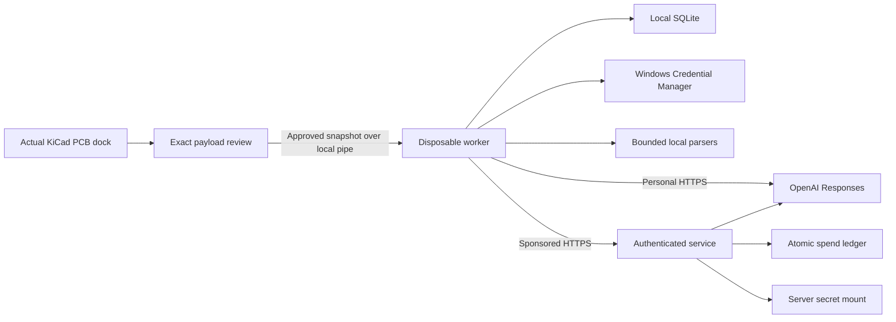

# Implementation architecture

The accepted host is an experimental PCB dock on Windows KiCad 10.0.7. The original ActionPlugin adds a wx panel to the editor's existing AUI manager; a strict host-version check rejects other versions. See ADR 001 for this internal interface's maintenance limits.

The GUI imports stdlib/wx and small policy helpers. Each operation uses KiCad's bundled Python with isolated vendored dependencies. Network, document/image parsing and SQLite run outside the GUI process. A reader thread delivers events with wx.CallAfter. Workers use private process pipes, no listening service, a 512 MiB Windows Job Object cap and operation deadlines. Resource-isolation failure prevents execution. No secrets travel on command lines.

SQLite stores stable conversation/message IDs and reviewed attachment snapshots. Replay uses those immutable copies, not mutable original files. Interrupted/failed/cancelled answers are labeled and excluded from automatically selected completed history. History count and total payload size are bounded; review lists omissions. Exports/database are local and not application-encrypted.

Shared request validation accepts only user/assistant messages, inline reviewed PNG images, model ID and output cap. There are no tools, remote URL fetches, arbitrary API parameters or design-write channels. Users can redact extracted text before constructing a request. The modal review holds a detached snapshot; confirming sends those input values, mode and destination.

The official OpenAI SDK uses foreground Responses streaming, `store=false`, verified TLS, a fixed OpenAI endpoint and zero automatic retries. Typed deltas/completion/errors are handled; partial text is periodically persisted and UI updates coalesced. Cancel terminates the worker/socket, without promising to undo already billed work. Sponsored disconnects close upstream streaming and keep unknown-cost reservations.

The supported default is `gpt-4.1-mini-2025-04-14`: Responses streaming, text/image input and text output. Personal model IDs are configurable; unsupported account/modality combinations produce errors. This does not certify every model. No provider Conversations object or automatic cloud sync is used. Provider retention is separate from `store=false`.

The FastAPI sponsored service authenticates high-entropy revocable tokens by hash and revalidates requests. A persistent single-host SQLite ledger serializes global/user budget and concurrency checks. Before inference it reserves the full supported model context plus output cap at conservative reviewed prices. Completed usage reconciles; unknown outcomes retain their charge. Idempotency cannot replay paid calls. Missing accounting, expired pricing review, exhausted allowance or disabled service fails closed. Kill/revocation checks run during streams. Only the server's read-only secret mount supplies the funded key.

The service initially permits one reviewed model policy. New models/prices require server review and tests. Deployment has no arbitrary proxy, remote tools, payment/subscription implementation or prompt persistence. BACKEND.md describes operational limits and recovery; ARCHITECTURE.md preserves the earlier feasibility proposal.

Guidance: [Responses streaming](https://developers.openai.com/api/docs/guides/streaming-responses), [official SDK](https://developers.openai.com/api/reference/python), [model capabilities/prices](https://developers.openai.com/api/docs/models/gpt-4.1-mini), [data controls](https://developers.openai.com/api/docs/guides/your-data). Locked SDK behavior is tested with mocked HTTP events; live validation is separate.
